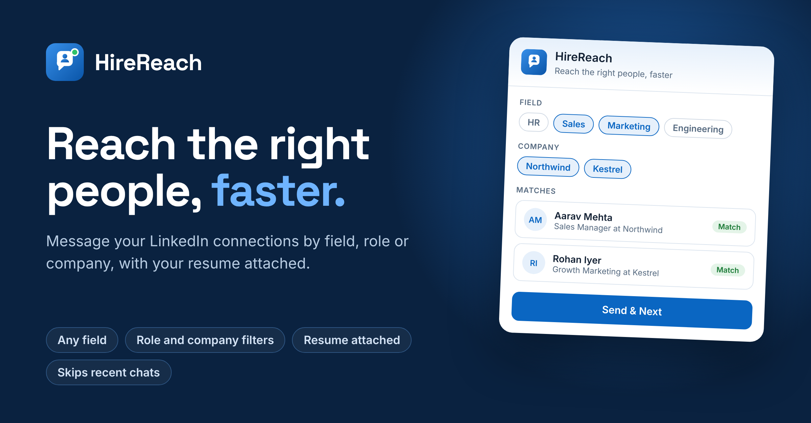

# HireReach

> Reach the right people, faster.

HireReach is a Chrome extension for personalised LinkedIn outreach. Pick any field (HR, sales, marketing, engineering and more), a role, or a company, and HireReach messages the matching people in your connections one by one, with an optional file such as your resume attached.



## Features

- **Any field or role**: quick-pick fields (HR & Recruiting, Sales, Marketing, Engineering, Product & Design, Data & AI, Finance, Leadership) or type your own keywords and positions.
- **Company filter**: reach only people at the companies you list, such as "Google" or "Infosys".
- **Skip words**: leave out headlines that contain words like "Intern" or "Student".
- **Pick people**: search, select all or clear, and review the matches before anything is sent.
- **Personalised message**: write once. `{firstName}`, `{company}` and `{role}` are filled in for each person, with a live preview.
- **File attachment**: attach a resume, PDF or image (up to 20 MB). It is added to every chat.
- **Send & Next**: opens each chat, fills the message, attaches the file and presses Send for you.
- **Skips recent chats**: people you messaged in the last 2 days (or whose chat has a Today/Yesterday message) are tagged and skipped.
- **Safe fallbacks**: if a chat box cannot be filled, a Copy message button lets you paste it yourself.

## Install (unpacked)

1. Download or clone this repository.
2. Open `chrome://extensions` and turn on **Developer mode**.
3. Click **Load unpacked** and select this folder (the one containing `manifest.json`).
4. Open <https://www.linkedin.com/mynetwork/invite-connect/connections/> and refresh the page.

## How to use

1. Click the **HireReach** button at the bottom of the page.
2. **Filter**: pick a field, or add keywords, companies and skip words, then click **Scan connections**.
3. **Matches**: tick the people you want to message.
4. **Message**: write your message (use First name, Company and Role buttons for personal touches), optionally click **Attach** to add a file.
5. **Send**: click **Send & Next**. HireReach sends the message and opens the next chat.

Use **Skip** to leave someone out and **Stop** to end the run at any time.

## Notes

- Keep to roughly 20-30 messages per day. LinkedIn may restrict accounts that send too many messages.
- The attached file is kept until you refresh the page.
- LinkedIn changes its page structure from time to time. If a chat box is not found, open the browser console and look for the `[HireReach] message box not found` warning.
- This project is not affiliated with or endorsed by LinkedIn. Use it responsibly and in line with LinkedIn's terms.

## Project structure

```
hirereach/
  manifest.json   Chrome extension manifest (MV3)
  content.js      UI panel and all logic (runs on LinkedIn)
  icons/          Extension icons and logo
```